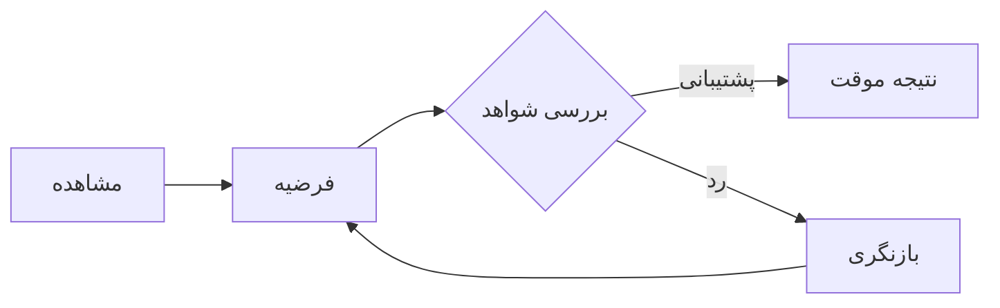

# منطقِ روشن

فکر کردن روشن، به معنی همیشه درست بودن نیست؛ به معنی توانایی **دیدن مسیر استدلال** و تشخیص نقطه‌های ضعف آن است.

<Callout type="note" title="ایدهٔ اصلی">
  یک استدلال معتبر، لزوماً مقدمات درستی ندارد. اعتبار منطقی و صدق مقدمات دو
  ویژگی متفاوت‌اند.
</Callout>

## ساختار یک استدلال

فرض کنید دو گزاره داریم: اگر باران ببارد، زمین خیس می‌شود؛ و اکنون باران می‌بارد. آن‌گاه نتیجه می‌گیریم زمین خیس است.

$$
(P \rightarrow Q) \land P \Rightarrow Q
$$

به این الگو **وضع مقدم** یا _Modus Ponens_ می‌گویند.

## منطق در برنامه‌نویسی

منطق در کد هم حضور دارد. تابع زیر یک مثال ساده از بررسی فرض است:

```python
from dataclasses import dataclass

@dataclass(frozen=True)
class Argument:
    premise: bool
    implication: bool

    def conclusion(self) -> bool:
        return self.premise and self.implication
```

<Figure
  id="logic-diagram"
  src="images/logic-diagram.svg"
  alt="نمودار ارتباط مشاهده، فرضیه و نتیجه"
  caption="شکل ۱ — از مشاهده تا نتیجه‌گیری"
/>

## مغالطه‌ها را بشناسیم

استدلال ممکن است از نظر ظاهری قانع‌کننده باشد، اما از الگوی معتبری پیروی نکند. یکی از خطاهای متداول، تأیید تالی است: «اگر P آنگاه Q؛ اکنون Q؛ پس P». چنین نتیجه‌ای لزوماً درست نیست.

<Callout type="tip" title="برای فکر کردن">
  پیش از پذیرفتن نتیجه، از خود بپرسید: آیا ممکن است مقدمات درست باشند ولی نتیجه
  غلط از آب درآید؟
</Callout>

## نمودار جریان استدلال


